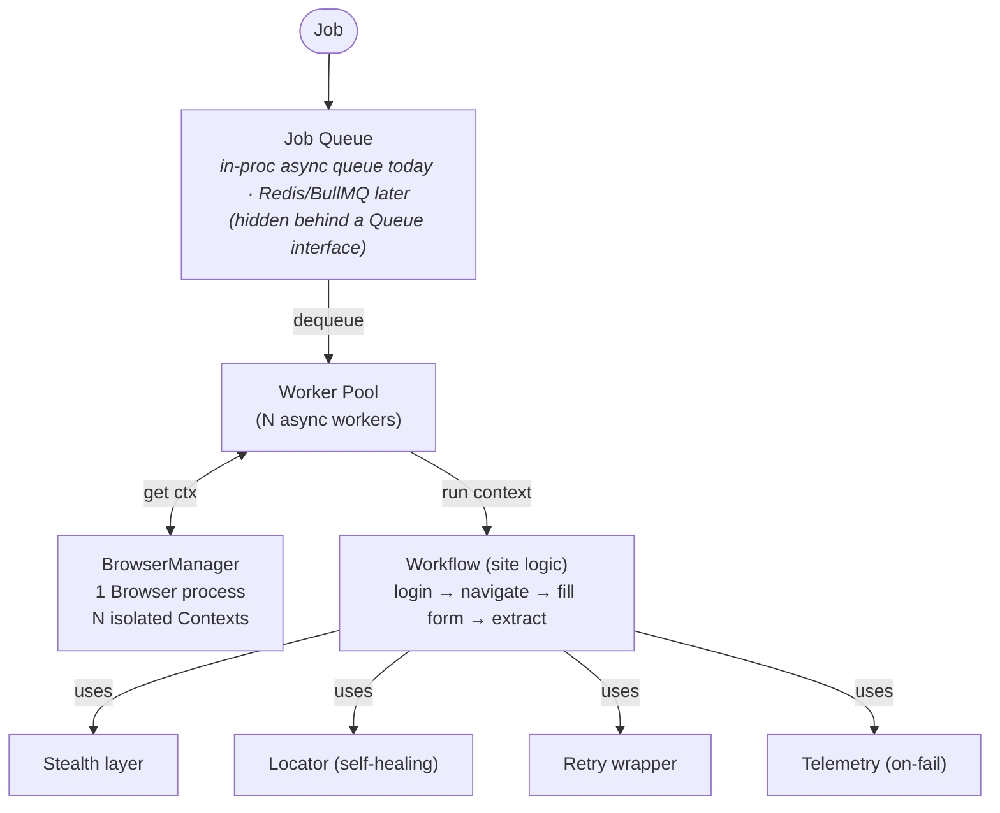
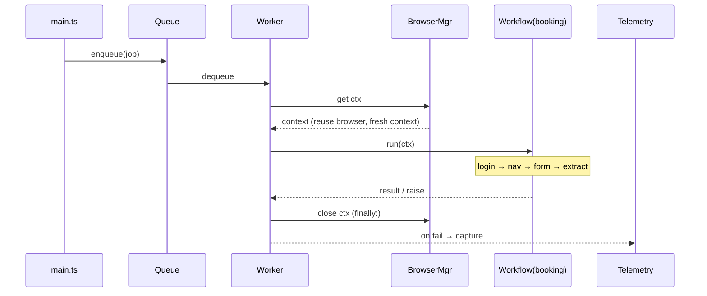
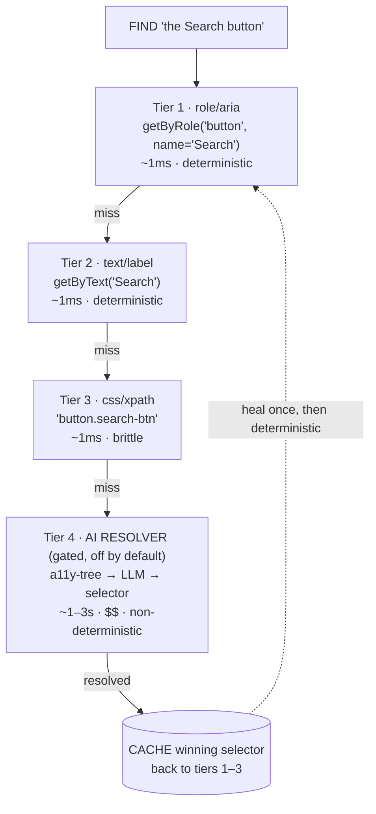

# Browser Automation Worker — Architecture & Flow

**Target:** Booking.com (real, bot-protected booking engine)
**Stack:** TypeScript · Node · Playwright (`playwright` library, CDP-based, async)
**Status:** Design for review

---

## 1. Thesis

We are building the **deterministic execution layer** — the "hands" — of a browser automation system: a resilient worker that logs in, persists its session, navigates a complex dynamic portal, and survives selector churn, network lag, and basic bot detection.

An AI/agent layer (e.g. Playwright-MCP-style) is the "brain" that decides *what* to do. It is explicitly **out of scope** for this build and sits *on top* of this worker. The worker is the hard, unglamorous infrastructure an agent is useless without: an LLM will not hide `navigator.webdriver`, persist a session, recycle browser contexts without leaking memory, or capture telemetry on failure. Engineers build that. We build that.

> **Design principle:** *AI decides, deterministic executes.* The better the deterministic layer, the less the AI layer has to do.

---

## 2. Requirements → Component map

Every hurdle in the assignment maps to exactly one owner. Nothing is orphaned, nothing is duplicated.

| Assignment hurdle | Owned by |
|---|---|
| Auth + session persistence | `workflows/booking.ts` + `storageState.json` |
| Deep nav + dynamic/dependent forms | `workflows/booking.ts` |
| Stealth (webdriver, UA, headers) + proxy layer | `core/stealth.ts` |
| Self-healing locators | `core/locators.ts` |
| Async orchestration (queue + worker) | `queue/` + `worker/` |
| Browser reuse + context isolation | `core/browserManager.ts` |
| Retry on transient failure | `core/retry.ts` |
| Telemetry on hard failure (log + screenshot + HTML) | `core/telemetry.ts` |

---

## 3. System architecture



### The seam that earns the grade
- **`worker` knows nothing about Booking.com.** It only knows `Workflow.run(context)`.
- **`workflow` knows nothing about queueing.** It only knows the page.
- Swapping Booking → flights → a fallback site is **one new file in `workflows/`**. Nothing else moves.

---

## 4. Repository layout

```
bravebird-automation/
├── src/
│   ├── core/
│   │   ├── browserManager.ts   # 1 browser, N isolated contexts, guaranteed cleanup
│   │   ├── stealth.ts          # webdriver patch, UA, headers, proxy config layer
│   │   ├── locators.ts         # self-healing: role → text → css → (gated) AI
│   │   ├── retry.ts            # async retry wrapper + telemetry hook
│   │   └── telemetry.ts        # on-fail: error log + screenshot + HTML + trace
│   ├── queue/
│   │   ├── base.ts             # Queue interface (swap in-proc ↔ Redis/BullMQ)
│   │   └── memoryQueue.ts      # in-process async queue implementation
│   ├── worker/
│   │   └── worker.ts           # async worker loop (site-agnostic)
│   ├── workflows/
│   │   ├── base.ts             # Workflow interface: login() → navigate() → extract()
│   │   └── booking.ts          # Booking.com implementation
│   ├── config.ts               # proxies, creds (env), UA pool
│   └── main.ts                 # enqueue jobs, start workers
├── package.json
├── tsconfig.json
└── README.md
```

---

## 5. End-to-end flow (one job)

**Job:** `{ site: booking, dest: "Goa", checkin: 2026-06-26, checkout: 2026-06-28, adults: 2 }`



### Inside `run(context)` — the four beats repeat at every step
Every interaction is **`find → wait → act → verify`**. Most bugs live in *wait*.

**1. Stealth applied** *(before any navigation)* — UA, locale, viewport, timezone set on the context; init script patches `navigator.webdriver → undefined`, plugins, WebGL. Must run before the page's JS or detection wins the race.

**2. Session check / login** — if `storage_state.json` exists, load it and verify ("is the account menu present?"); if valid, skip login. Otherwise log in, follow the post-login redirect, and snapshot `storage_state` for next run. *"Am I still logged in?" is a check, not an assumption.*

**3. Navigate** — `goto(booking.com)`; **dismiss the consent banner** (it overlays the search box and steals clicks). If a bot wall appears instead of the page → fail path.

**4. Destination autocomplete** *(the hard one)* —
```
FIND   destination input   → getByRole("combobox", name~="destination")   tier 1
ACT    type "Goa"          → fires a debounced XHR
WAIT   for the OPTIONS      → wait for listbox option, never sleep()        ← key
ACT    click "Goa, India"
VERIFY input reads "Goa, India"
```
Wrapped in **retry**; locator falls through tiers on markup change.

**5. Date picker** — open calendar, click check-in then check-out (checkout enables only after check-in — dependent field). Verify both.

**6. Occupancy stepper** — open guests popover, increment adults to 2, verify count.

**7. Submit + extract** — click Search, wait for results to render, read structured data (or read the results XHR JSON directly — faster, less brittle). Return; worker closes the context in `finally:`.

### Failure path (equally important)
On a bot wall or exhausted retries, **telemetry fires on the way out**: `error.log` (exception + step + job id), `screenshot.png`, `page.html`, and a Playwright **trace** (replayable timeline). The context is still closed in `finally:` — **no leaked browser, even on failure** — and the worker loops to the next job.

---

## 6. Self-healing locator strategy

A cost-ordered cascade. Cheap and deterministic first; expensive and non-deterministic only as a last resort.



**Tier 4 is off by default, behind a config flag.** When it does fire, it **heals once** — the resolved selector is cached, so every subsequent run is deterministic again. We feed the model the **accessibility tree**, not raw HTML or a screenshot: cheaper tokens, deterministic to parse, already encodes roles/labels.

> The senior signal is not "I used an LLM." It is "I used an LLM **once**, behind a flag, then fell back to a cached deterministic selector — because at scale, 3 seconds and a per-call cost on every lookup is unacceptable."

---

## 7. Tradeoffs & real-world limits

- **Booking.com bot detection (DataDome/Akamai-class) is aggressive and can be flaky.** We treat the anti-bot wall as a *first-class failure*, not a bug to brute-force. A **deterministic fallback target** (SauceDemo / local static form) is wired into the same `Workflow` interface, so the engine is provable even when the wall is up. Handling the wall gracefully is a rubric requirement, not a cop-out.
- **Stealth has a ceiling.** JS patches defeat static checks (`navigator.webdriver`) but not network-layer fingerprints (TLS/JA3, HTTP/2). Defeating those needs real browsers + residential proxies — hence the **proxy abstraction layer** in `stealth.ts`, even though we run direct by default.
- **Queue starts in-process** (a small async queue / `Promise`-based handoff) for reviewability; the `Queue` interface lets it become Redis/BullMQ without touching workflow code. Right-sized, not over-built.
- **One browser, many contexts.** Contexts cost ~50–100MB each, so concurrency is capped and every context is closed in `finally:` — the difference between a worker that runs for an hour and one that runs for a week.
- **Prefer reading XHR JSON over scraping the DOM** where the site allows it: faster and far less brittle than parsing rendered cards.

---

## 8. Build order

1. `BrowserManager` + `stealth` — launch a stealthed context, verify against a `navigator.webdriver` detection page.
2. `locators` self-healing layer (standalone, testable).
3. `BookingWorkflow` happy path against the live site.
4. `queue` + `worker` — wrap it async.
5. `retry` + `telemetry` — cross-cutting robustness.
6. README with the tradeoff write-up.

---

*This document is the worker (the "hands"). The agent layer (the "brain") plugs in on top later — and is cheaper and more reliable precisely because this layer did the deterministic heavy lifting underneath.*
