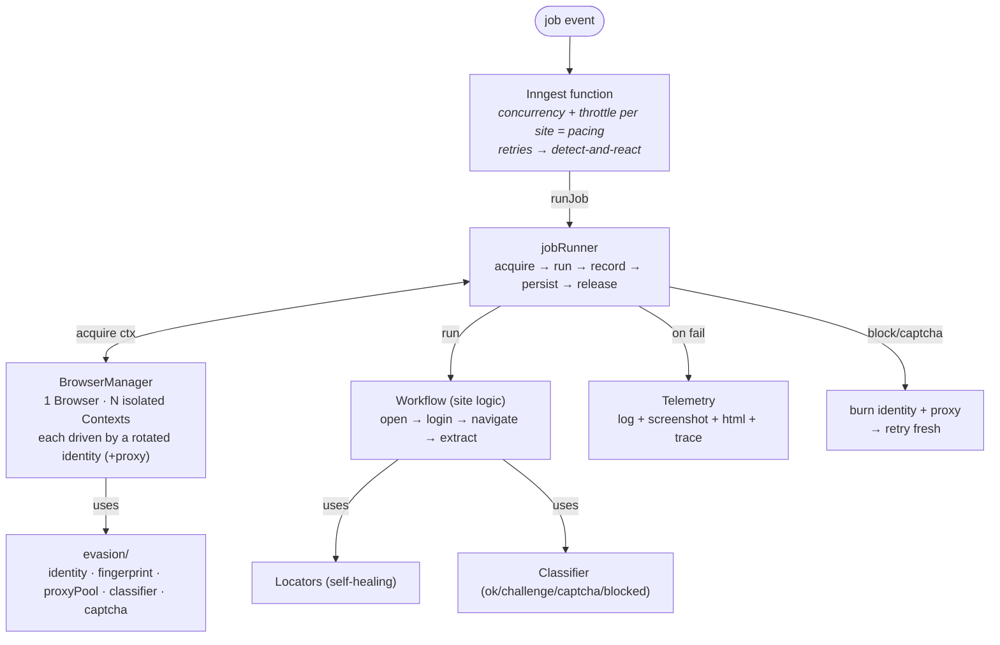
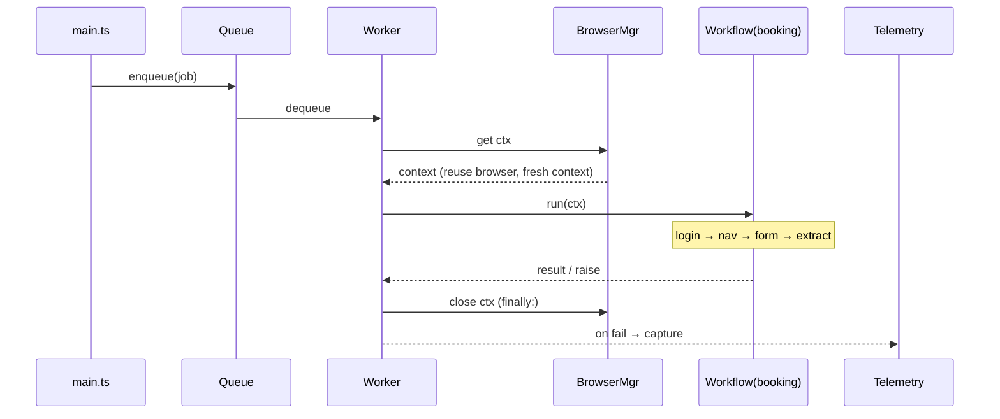
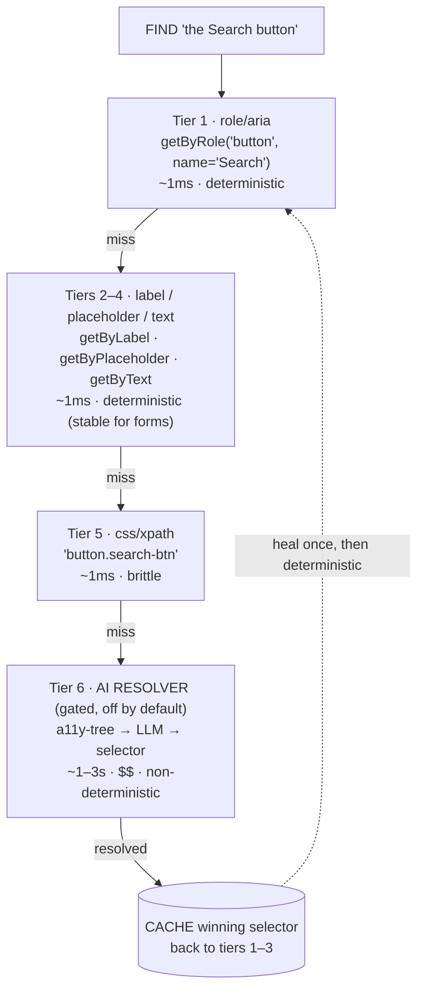
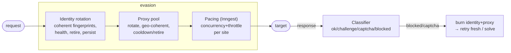

# Browser Automation Worker — Architecture & Flow

**Target:** Booking.com (real, bot-protected booking engine)
**Stack:** TypeScript · Node · Playwright (Chromium) · Inngest (orchestration) · OpenRouter (gated AI) · Apify fingerprint-suite
**Status:** Implemented — built for scale

---

## 1. Thesis

This is the **deterministic execution layer** — the "hands" — of a browser automation system: a resilient worker that logs in, persists its session, navigates a complex dynamic portal, and survives selector churn, network lag, and aggressive bot detection. Built **for scale**: the headline concern is how bot detection and CAPTCHA are handled across a fleet of workers, not just one browser.

It splits into three cleanly-separated layers:
- **`core/`** — the browser engine: one Chromium, N isolated contexts, stealth, self-healing locators, telemetry.
- **`evasion/`** — the anti-bot subsystem: durable identities + real fingerprints, proxy pool, response classifier, CAPTCHA solver.
- **`orchestration/`** — Inngest: paces jobs and does detect-and-react retries. The lower layers are orchestration-agnostic.

> **Design principle:** *AI decides, deterministic executes; avoid > solve.* Cheap, deterministic, reversible paths first (role-based locators, good fingerprints, pacing); expensive/non-deterministic ones (LLMs, CAPTCHA services, residential proxies) only as **gated last resorts**.

---

## 2. Requirements → Component map

Every hurdle in the assignment maps to exactly one owner. Nothing is orphaned, nothing is duplicated.

| Assignment hurdle | Owned by |
|---|---|
| Auth + session persistence | `evasion/identity.ts` (per-identity session) + `core/browserManager.ts` |
| Deep nav + dynamic/dependent forms | `workflows/booking.ts` |
| Stealth (webdriver, UA, headers) | `core/stealth.ts` + `evasion/fingerprint.ts` |
| Proxy abstraction | `evasion/proxyPool.ts` |
| Self-healing locators | `core/locators.ts` + `core/aiResolver.ts` (gated AI) |
| Async orchestration | `orchestration/` (Inngest) + `orchestration/jobRunner.ts` |
| Browser reuse + context isolation | `core/browserManager.ts` |
| Retry on transient failure | Inngest retries + `orchestration/jobRunner.ts` (detect-and-react) |
| Telemetry on hard failure (log + screenshot + HTML + trace) | `core/telemetry.ts` |
| **Bot detection + CAPTCHA at scale** | `evasion/` (identity rotation, proxy pool, classifier, captcha) |

---

## 3. System architecture



### The seam that earns the grade
- **Orchestration knows nothing about Booking.com.** It only knows `runJob(job)`.
- **The workflow knows nothing about orchestration.** It only knows the page.
- **The evasion layer knows nothing about either.** Identities/proxies are injected.
- Swapping Booking → flights → another site is **one new file in `workflows/`** + one `registry` entry. Nothing else moves. Swapping orchestration (Inngest ↔ in-process) leaves the lower layers untouched.

---

## 4. Repository layout

```
bravebird-automation/
├── src/
│   ├── core/
│   │   ├── browserManager.ts   # 1 browser, N isolated contexts, identity+proxy, trace, cleanup
│   │   ├── stealth.ts          # webdriver/WebGL patches, proxy parsing (identity-driven)
│   │   ├── locators.ts         # self-healing: role→label→placeholder→text→css→(gated) AI
│   │   ├── aiResolver.ts       # Tier-4: a11y-tree → OpenRouter → selector (gated, cached)
│   │   └── telemetry.ts        # on-fail: error log + screenshot + HTML + trace + sink
│   ├── evasion/                # the anti-bot subsystem (built for scale)
│   │   ├── identity.ts         # durable personas: rotation, quota, health, retire, persist
│   │   ├── fingerprint.ts      # real coherent fingerprints (generator+injector) + quality gate
│   │   ├── profiles.ts         # curated fallback profiles (zero-dependency)
│   │   ├── proxyPool.ts        # rotation, sticky-per-identity, geo-coherence, cooldown/retire
│   │   ├── classifier.ts       # response → ok | challenge | captcha | blocked
│   │   └── captcha/            # Strategy+Factory solver (math · vision · token-service · mock)
│   ├── workflows/
│   │   ├── base.ts             # Workflow ABC: open → (login) → navigate → extract; BotWallError
│   │   └── booking.ts          # Booking.com implementation
│   ├── orchestration/
│   │   ├── inngest.ts          # client + function (concurrency/throttle/retries)
│   │   ├── serve.ts            # Node HTTP server hosting the functions
│   │   ├── jobRunner.ts        # runJob + detect-and-react; local retry loop
│   │   └── registry.ts         # site → Workflow
│   ├── scripts/                # runnable verifications + recon + live demo
│   ├── config.ts               # env (zod-validated), single source of truth
│   └── main.ts                 # zero-infra direct worker pool
├── package.json · tsconfig.json · .env.example · README.md
```

---

## 5. End-to-end flow (one job)

**Job:** `{ site: booking, dest: "Goa", checkin: 2026-06-26, checkout: 2026-06-28, adults: 2 }`



### Inside `run(context)` — the four beats repeat at every step
Every interaction is **`find → wait → act → verify`**. Most bugs live in *wait*.

**1. Stealth applied** *(before any navigation)* — UA, locale, viewport, timezone set on the context; init script patches `navigator.webdriver → undefined`, plugins, WebGL. Must run before the page's JS or detection wins the race.

**2. Session check / login** — the **identity owns its session**: `BrowserManager` loads the persona's `storageState` automatically; the workflow verifies ("is the account menu present?") and logs in only if stale, then `persistSession` snapshots it. *"Am I still logged in?" is a check, not an assumption.*

**3. Navigate** — `goto(booking.com)`; the **classifier** checks the response (`blocked`/`captcha` → `BotWallError` → detect-and-react). **Dismiss consent + sign-in modals** — Booking's sign-in modal steals focus mid-type and kills autocomplete, so the destination step *dismisses the modal and re-types* (a few attempts) before treating it as a degraded variant.

**4. Destination autocomplete** *(the hard one)* —
```
FIND   destination input   → getByRole("combobox", name~="destination")   tier 1
ACT    type "Goa"          → fires a debounced XHR
WAIT   for the OPTIONS      → wait for listbox option, never sleep()        ← key
ACT    click "Goa, India"
VERIFY input reads "Goa, India"
```
Wrapped in **retry**; locator falls through tiers on markup change.

**5. Date picker** — open calendar, click check-in then check-out (checkout enables only after check-in — dependent field). Verify both.

**6. Occupancy stepper** — open guests popover, increment adults to 2, verify count.

**7. Submit + extract** — click Search, wait for results to render, read structured data (or read the results XHR JSON directly — faster, less brittle). Return; worker closes the context in `finally:`.

### Failure path (equally important)
On a bot wall or exhausted retries, **telemetry fires on the way out**: `error.log` (exception + step + job id), `screenshot.png`, `page.html`, and a Playwright **trace** (replayable timeline). The context is still closed in `finally:` — **no leaked browser, even on failure** — and the worker loops to the next job.

---

## 6. Self-healing locator strategy

A cost-ordered cascade. Cheap and deterministic first; expensive and non-deterministic only as a last resort.



**Tier 4 is off by default, behind a config flag.** When it does fire, it **heals once** — the resolved selector is cached, so every subsequent run is deterministic again. We feed the model the **accessibility tree**, not raw HTML or a screenshot: cheaper tokens, deterministic to parse, already encodes roles/labels.

> The senior signal is not "I used an LLM." It is "I used an LLM **once**, behind a flag, then fell back to a cached deterministic selector — because at scale, 3 seconds and a per-call cost on every lookup is unacceptable."

---

## 7. Bot detection & CAPTCHA at scale (the headline)

One stealthed browser fools static checks. **At scale you're caught by patterns** —
three signals expose a bot farm, each with an owner.



- **Identical fingerprints → coherent identity rotation.** Real, statistically-distributed
  fingerprints (Apify generator+injector), **quality-gated** to the plausible middle.
  Identities are durable personas: sticky-per-session, daily quota, health-graded,
  auto-retired when burned, persisted to disk.
- **One IP → proxy pool.** Rotate, **sticky-per-identity**, **geo-coherent** (US persona →
  US IP), cooldown + retire on blocks. Empty pool → direct.
- **Bursts → pacing.** Inngest `concurrency` + `throttle` keyed per site — 1k workers
  never burst one target.
- **Caught anyway → detect-and-react.** The classifier flags a block; `jobRunner` burns
  the identity + proxy; the retry runs on a **fresh persona + IP**.
- **CAPTCHA: avoid > solve.** A Strategy+Factory solver (`math` · `vision` · `token-service`
  · `mock`) handles the rare puzzle that slips through; off by default. Solving the puzzle
  ≠ passing — modern systems score behavior, not pictures — so we invest in *not being
  challenged*.

---

## 8. Tradeoffs & real-world limits

- **Stealth has a ceiling.** JS patches defeat static checks (`navigator.webdriver`) but not
  **network-layer** fingerprints (TLS/JA3, **IP reputation**). Booking (DataDome-class) scores
  the IP heavily — from one un-proxied IP, ~30% of runs get a degraded variant. The architecture
  is built for the fix (residential proxies + pacing); verifying it *live* needs a paid proxy.
- **Anti-bot wall is a first-class failure**, not a bug to brute-force — `BotWallError` →
  detect-and-react rotation, telemetry on the way out. (SauceDemo fallback was dropped per the
  scale pivot: the founder asked for a real bot-protected target.)
- **Orchestration is Inngest-native** for flow control (pacing) + durable retries; a zero-infra
  in-process worker pool (`main.ts`) is kept for review. The lower layers are orchestration-agnostic.
- **One browser, many contexts.** Contexts cost ~50–100MB; concurrency is capped and every
  context is closed in `finally` — a worker that runs for a week, not an hour.
- **What needs a paid account to verify live:** residential proxies (IP swap), 2Captcha
  (token solving), OpenRouter (AI locator / vision CAPTCHA — cheap). Everything else is verified
  offline via `npm run *:check`.

---

## 9. Build order & verification

Built bottom-up; each layer is independently runnable (`npm run *:check`, no accounts).

| # | Layer | Verify |
|---|---|---|
| M1 | BrowserManager + stealth | `stealth:check` — webdriver hidden vs bot.sannysoft |
| M2 | Self-healing locators (+ gated AI) | `locators:check`, `ai:check` |
| M3 | Booking workflow (find→wait→act→verify) | `booking` — real Goa properties |
| M4 | Identity + fingerprint rotation | `identity:check`, `fingerprint:check` |
| M5 | Proxy pool | `proxy:check` — incl. a real proxy is applied |
| M6 | Classifier + CAPTCHA (Strategy/Factory) | `captcha:check` — 7 response types |
| M7 | Inngest orchestration + detect-and-react | `orchestration:check` — block → rotate → success |
| M8 | Telemetry + README/ARCHITECTURE | `telemetry:check` — log+shot+html+trace |

---

*The "hands" are now backed by an evasion subsystem and an orchestration layer — so a
"brain" (agent) plugging in on top is cheaper and more reliable, precisely because this
layer does the deterministic, anti-bot, and pacing heavy lifting underneath.*
